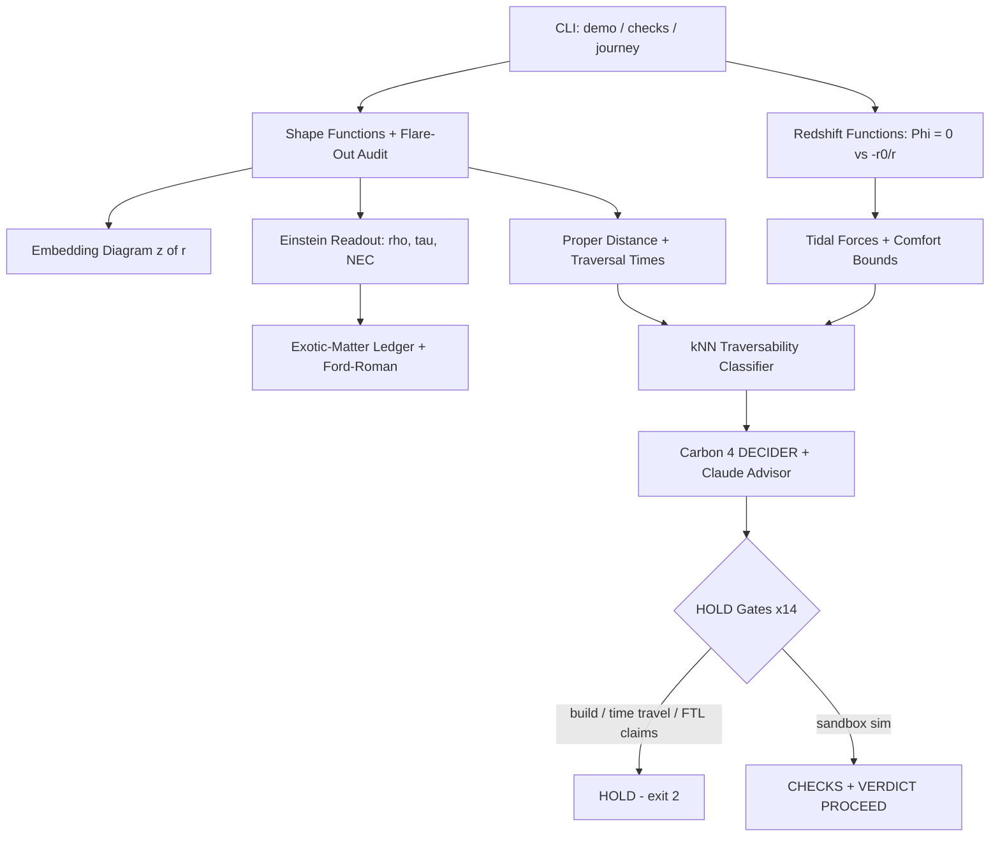
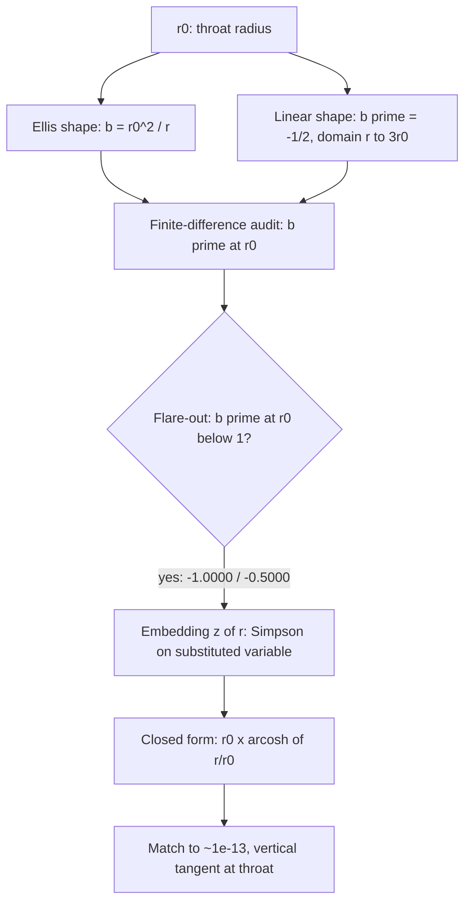
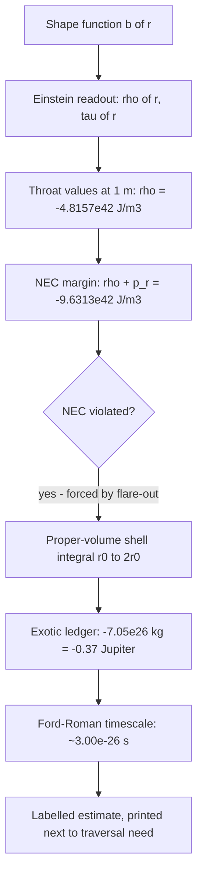
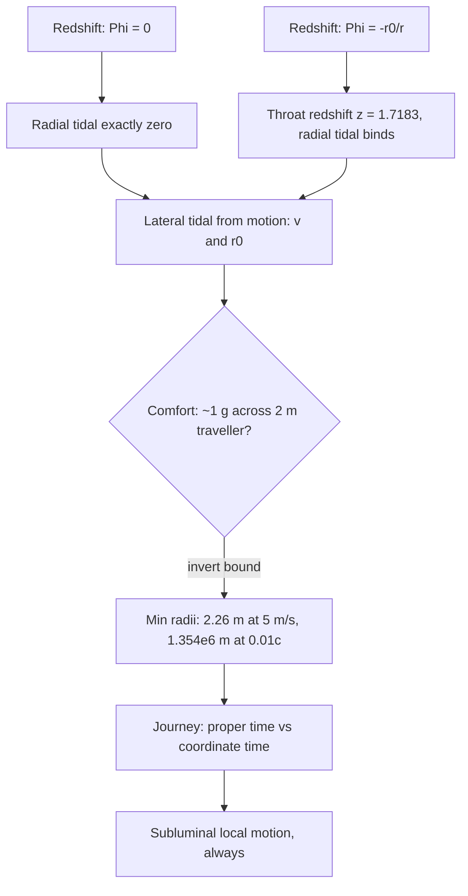
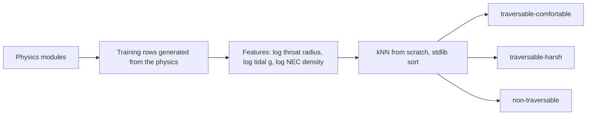
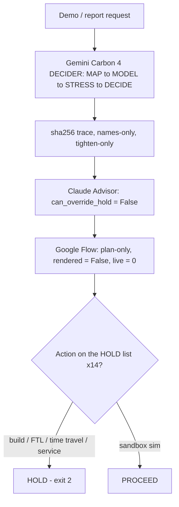
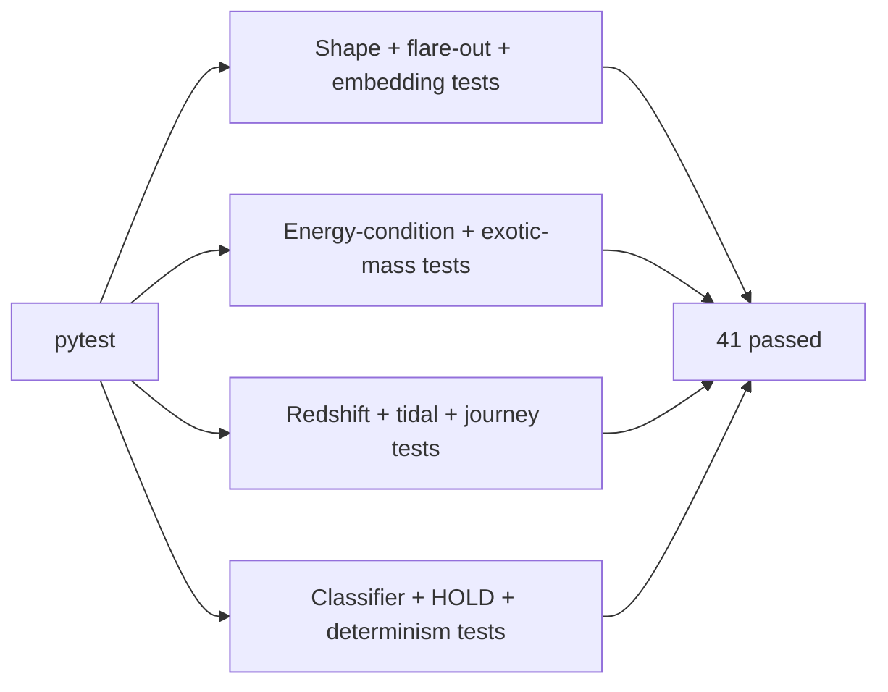
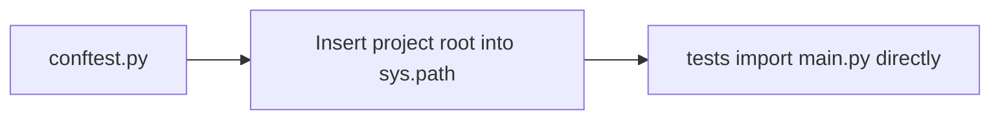
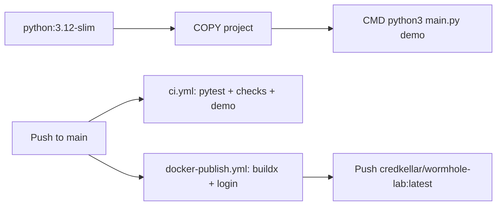

# Wormhole-Lab 🌀🌌

**Morris–Thorne Wormhole Physics Lab** — by Darion Kellar

Wormhole-Lab is an **educational traversable-wormhole lab** in ONE pure-Python file. It works inside the **Morris–Thorne metric** (1988) — the spacetime Morris and Thorne wrote down when they asked what a traversable wormhole would actually require:

- **The geometry** = two standard **shape functions** (Ellis b(r) = r0²/r and a linear profile), the **flare-out condition** b′(r0) < 1 verified numerically, and the **embedding diagram** z(r) integrated numerically and matched to its closed form r0·arcosh(r/r0). 📐
- **The price** = both **redshift functions** (Φ = 0 and Φ = −r0/r), the **tidal-force comfort bounds** Morris and Thorne derived, a labelled **traversal-time** journey — and the honest headline: **the Einstein equations themselves demand exotic matter at the throat** (ρ = −4.82×10⁴² J/m³ and ρ + p_r = −9.63×10⁴² J/m³ for a 1 m throat), a null-energy-condition violation no engineering can vote away. ⚖️

Honest scope, stated up front: **no wormhole has ever been observed or built**, and sustained macroscopic negative energy is unproven physics. This lab operates **nothing real**: it computes geometry and prints the bill. Every build / time-travel / FTL / service claim sits behind a permanent HOLD gate (14 total). 🔒

[](https://github.com/kimanicollier44-cmyk/Wormhole-Lab/actions/workflows/ci.yml)
[](https://github.com/kimanicollier44-cmyk/Wormhole-Lab/actions/workflows/docker-publish.yml)

> ℹ️ These are the **live** workflow badges for this repo. They activate as soon as the `ci.yml` and `docker-publish.yml` files from the paste pack are pasted into `.github/workflows/` — until then they have nothing to report yet.

## 🧰 Tech Stack Badges & Full Architecture Tech Stack

### 💻 Core Programming Languages & Core Systems


- 🐍 Python 3.12, pure standard library (`math`, `hashlib`, `json`, `sys`) — zero dependencies, zero network, deterministic (double-run byte-identical), ONE file: `main.py`
- 🌀 Physics core: Morris–Thorne shape functions with numeric flare-out audit, embedding-diagram integration (Simpson on a singularity-removing substitution, checked against the closed form), Einstein-equation energy density / tension readout, proper-distance and lapse-weighted traversal integrals, tidal Riemann components, Ford–Roman timescale estimate
- 🧠 TinyML kNN traversability classifier (from scratch, stdlib) on (log₁₀ throat radius, log₁₀ tidal g, log₁₀ |NEC density|) — training rows generated from the physics itself
- 🪑 Council seats: Gemini Carbon 4 DECIDER (names-only, tighten-only) + Muse advisor (never overrides HOLD) + Google Flow plan-only (rendered = False, live = 0)

### ⛓️ Web3 & Infrastructure

- 🚫 **Not applicable — honestly.** No blockchain, no Web3, no tokens: the "infrastructure" in this lab is the Morris–Thorne geometry itself, computed inside one offline file. No fake badges here.

### ⚙️ Platform Support & Hardware Architecture


- 🖥️ Pure Python — runs anywhere Python 3.12+ runs (Linux, macOS, Windows, any CPU architecture), plus the `python:3.12-slim` Docker image
- 🔒 No hardware is controlled, ever: real gravitational, vacuum, or accelerator equipment is a permanent HOLD gate (see the gate table below)

### ⚡ Low-Level Infrastructure & Performance

- 🚫 **No low-level code — honestly.** No C, no C++, no GPU, no compiled extensions: this is one interpreted Python file on purpose, so every number can be read, checked, and diffed. Performance here means honest algorithms — closed-form physics wherever it exists (embedding, proper distance, throat values), with iteration only in the Simpson quadratures, the station-radius bisection, and the kNN sort — all deterministic and byte-identical between runs.

### 🛠️ DevOps & Build Tools


- 🐳 Docker (`python:3.12-slim`), GitHub Actions CI + Docker Publish (delivered in the paste pack)
- 🎯 Target image: `credkellar/wormhole-lab:latest`
- 🧪 Tests: `pytest` (41 tests) + the built-in CHECKS suite (67 checks) in `main.py`

### ☁️ Cloud Providers

- 🚫 **None — honestly.** No cloud provider is used or needed: the lab runs fully offline on your own machine or in a local Docker container. Docker Hub appears only as the registry the publish workflow pushes the image to.

## What this does?

1. 📐 **Shape functions, audited** — the Morris–Thorne shape function b(r) fixes the tunnel's profile. Two standard choices: Ellis b(r) = r0²/r with b′(r0) = −1, and a linear profile with b′(r0) = −1/2 (labelled domain r ≤ 3r0). Both satisfy b(r0) = r0 and b(r) < r, and the **flare-out condition b′(r0) < 1 is verified numerically** (finite differences: −1.0000 and −0.5000), not just asserted from the algebra.
2. 🫧 **The embedding diagram** — the famous funnel, computed: z(r) = ∫√(b/(r−b)) dr with the throat singularity removed by substitution and integrated by Simpson's rule. It matches the Ellis closed form z = r0·arcosh(r/r0) to ~1e-13 relative error (z(2r0) = 1.3169579 r0), and the tangent at the throat is vertical, as the picture demands.
3. ⚖️ **The Einstein equations send the bill** — ρ(r) and the radial tension τ(r) are *read off* the metric, not chosen: at a 1 m Ellis throat, ρ = −4.8157×10⁴² J/m³ (−5.36×10²⁵ kg/m³ mass-equivalent) and ρ + p_r = −9.6313×10⁴² J/m³. The **null energy condition is violated**, and the lab shows it is forced: flare-out geometry and NEC violation are the same statement.
4. 🪐 **The exotic-matter ledger** — integrating ρ/c² over the proper volume of the throat shell (r0 → 2r0) gives **−7.05×10²⁶ kg ≈ −0.37 Jupiter masses** of exotic matter for a 1 m throat, scaling linearly with r0 — next to the characteristic scale c²/G = 1.35×10²⁷ kg per metre of throat.
5. ⏱️ **Ford–Roman reality check** — quantum inequalities bound how long negative energy may persist: τ ~ (ħ/(|ρ|c³))^¼ ≈ **3.00×10⁻²⁶ s** at throat density (labelled order-of-magnitude estimate), against the seconds a traveller would need. The gap between those numbers is the honest state of the art.
6. 🔴 **Two redshift functions** — Φ = 0 (the zero-tidal-force wormhole: no redshift anywhere, no horizon) vs Φ = −r0/r (a photon climbing out of the throat is redshifted by z = e − 1 = 1.7183; z = 0.6487 at 2r0, 0.1052 at 10r0). Both keep e^{2Φ} > 0 everywhere — no event horizon, by construction.
7. 🧍 **Tidal comfort, Morris–Thorne style** — the traveller is 2 m of head-to-foot, and the comfort bound is ~1 g across the body. With Φ = 0 the **radial tidal is exactly zero** everywhere; the **lateral** tidal from motion binds instead: at 0.01 c a 1 m throat pulls 1.80×10¹³ m/s² across you, while a 1000 km throat pulls 17.98 m/s² (1.83 g).
8. 📏 **Minimum throat radii** — inverting the comfort bound: crawl at 5 m/s and r0 ≥ **2.26 m** suffices; cross at 0.001 c → **1.354×10⁵ m**; at 0.01 c → **1.354×10⁶ m**; at 0.1 c → **1.361×10⁷ m**. Pick Φ = −r0/r instead and the *radial* tidal binds even standing still: r0 ≥ **1.353×10⁸ m**. Cross slowly or build big.
9. 🚀 **One labelled journey** — r0 = 10 m, stations at 5,000 m proper distance on both sides, ship at 0.02 c: traveller proper time **1.6675 ms**, coordinate time **1.6678 ms** (Φ = 0) or **1.6942 ms** (Φ = −r0/r — distant clocks wait longer past a redshifted throat). A shortcut through space, never through the traveller's own clock: local motion is subluminal the whole way.
10. 🏷️ **kNN traversability classifier** — labels any design `traversable-comfortable` / `traversable-harsh` / `non-traversable` from (throat radius, tidal load, NEC density): the 1 m backyard throat and the 1 km lab throat are non-traversable, 1000 km is harsh (1.83 g), 3000 km and 10⁸ m are comfortable.
11. 🧠 **Advisory seats + checks** — Carbon 4 DECIDER with sha256 trace, Muse advisor, Google Flow plan-only, and a built-in CHECKS suite (67 checks).

## 🗺️ How it works — diagram per script

### `main.py` — the whole lab (master diagram)



### `main.py` — shape functions & embedding subsystem



### `main.py` — energy-condition & exotic-matter ledger subsystem



### `main.py` — redshift, tidal & journey subsystem



### `main.py` — kNN traversability classifier subsystem



### `main.py` — council seats & HOLD subsystem



### `tests/test_main.py` — verification



### `conftest.py` — test path setup



### `Dockerfile` + CI flow — container & publish



## Why is this cool?

1. 🌀 The tunnel is real mathematics: Morris and Thorne wrote down a metric that Einstein's equations genuinely allow — this lab computes in it, exactly, instead of waving at it.
2. 🫧 The funnel picture stops being clip-art: the embedding curve is integrated numerically and proven against its closed form to thirteen digits.
3. ⚖️ The exotic matter is not a plot device — it falls out of the field equations. Change the shape, the invoice changes; the sign never does.
4. 🪐 The numbers have Jupiter in them: a one-metre throat carries a −0.37-Jupiter-mass exotic ledger. Spacetime shortcuts are priced in planets.
5. ⏱️ The Ford–Roman bound turns "just add negative energy" into a timescale: 10⁻²⁶ seconds of permission versus seconds of need — a 26-orders-of-magnitude honesty gap, printed.
6. 🧍 Comfort is a size requirement, not a vibe: the same formula that shreds a traveller at a 1 m throat (10¹³ m/s²) certifies a 3000 km throat at 0.2 g.
7. 🔴 Two wormholes, two clocks: Φ = 0 and Φ = −r0/r give the traveller the same proper time but charge distant observers different coordinate times — gravitational redshift you can watch in milliseconds.
8. 🚫 It refuses the movie version politely but completely: no observation, no construction, no time machine — 14 HOLD gates, and hold-demo exits 2.
9. 🏷️ A tiny from-scratch ML classifier learns the traversability map from the physics itself — its training rows are computed, not collected.
10. 🎯 Deterministic end to end: run it twice, get byte-identical output — general relativity you can diff.

## What problems this solves?

1. ❌ **Problem:** Wormholes are usually presented as pure fantasy or pure hype. ✅ **Solution:** The lab works in the actual Morris–Thorne metric with its actual conditions — flare-out verified numerically, embedding verified against the closed form.
2. ❌ **Problem:** "Exotic matter" gets mentioned without a price tag. ✅ **Solution:** The energy density, the NEC margin, and the shell-integrated exotic mass (−7.05×10²⁶ kg for 1 m) are computed and printed next to every pretty funnel.
3. ❌ **Problem:** People assume a human-sized throat is human-usable. ✅ **Solution:** The tidal module applies the 1 g-over-2 m comfort bound and shows the 1 m throat pulling 1.8×10¹³ m/s² — and exactly how big (or how slow) fixes it.
4. ❌ **Problem:** "Zero tidal force" sounds like marketing. ✅ **Solution:** The radial tidal component is computed from the Riemann tensor and is *exactly* zero for Φ = 0 — and nonzero for Φ = −r0/r, where it becomes the binding constraint (r0 ≥ 1.35×10⁸ m).
5. ❌ **Problem:** Traversal stories imply faster-than-light travel. ✅ **Solution:** The journey module separates traveller proper time from coordinate time and shows local motion stays subluminal; FTL claims are a permanent HOLD gate.
6. ❌ **Problem:** Time-machine claims ride along with wormhole math. ✅ **Solution:** Closed-timelike-curve talk is labelled speculative and gated; the lab computes geometry, not chronology protection violations.
7. ❌ **Problem:** Quantum negative energy (Casimir-style) is treated as a construction material. ✅ **Solution:** The Ford–Roman timescale (~3×10⁻²⁶ s at throat density) is computed and placed next to the traversal timescale it would have to sustain.
8. ❌ **Problem:** Redshift/horizon confusion — "isn't the throat a black hole?" ✅ **Solution:** Both redshift functions are shown to keep e^{2Φ} > 0 everywhere with Φ → 0 at infinity: redshift yes (z = 1.7183 at the Φ = −r0/r throat), horizon no.
9. ❌ **Problem:** Physics code usually needs numpy / scipy installs. ✅ **Solution:** Pure standard library — the quadratures are hand-rolled Simpson with a singularity-removing substitution; runs anywhere Python 3.12 runs.
10. ❌ **Problem:** Simulation tools quietly imply engineering readiness. ✅ **Solution:** The journey is labelled an example, the Ford–Roman figure is labelled an estimate, the linear shape carries its domain limit, and 14 HOLD gates return exit code 2 for every build, service, and discovery claim.

## How to install this?

1. 📋 Clone this repo:

```bash
git clone https://github.com/kimanicollier44-cmyk/Wormhole-Lab.git
cd Wormhole-Lab
```

2. 🐍 Make sure Python 3.12+ is installed: `python3 --version`
3. ▶️ Run the full demo + checks (no arguments needed):

```bash
python3 main.py
```

4. 🧪 Run the test suite:

```bash
pip install pytest
python3 -m pytest -q
```

5. 🎛️ Try the other commands:

```bash
python3 main.py checks    # 67 built-in checks
python3 main.py shape     # shape functions + flare-out as JSON
python3 main.py embedding # embedding diagram z(r) table as JSON
python3 main.py energy    # rho / tau / NEC / exotic ledger as JSON
python3 main.py redshift  # Phi = 0 vs Phi = -r0/r redshifts as JSON
python3 main.py tidal     # tidal forces + minimum throat radii as JSON
python3 main.py journey   # the labelled example journey as JSON
python3 main.py classify  # kNN traversability verdicts
python3 main.py brains    # Carbon 4 + Muse + Flow seats
python3 main.py holds     # list all 14 HOLD gates
python3 main.py hold-demo # exits 2 - gated actions stay HOLD
```

6. 🐳 Or run it in Docker:

```bash
docker pull credkellar/wormhole-lab:latest
docker run --rm credkellar/wormhole-lab:latest
```

—or build it yourself:

```bash
docker build -t credkellar/wormhole-lab:latest .
docker run --rm credkellar/wormhole-lab:latest
```

## Requirements

- 🐍 Python 3.12 or newer
- 📦 Dependencies: **none** (standard library only)
- 🌐 Network: **none** — fully offline
- 🧪 For tests only: `pytest`
- 🐳 Optional: Docker

## FULL project structure tree

```text
wormhole-lab/
├── main.py                  # the whole lab: shape functions, embedding, energy conditions, redshift, tidal bounds, journey, classifier, seats, HOLD gates
├── conftest.py              # puts the project root on sys.path for tests
├── tests/
│   └── test_main.py         # 41 pytest tests: shapes, flare-out, embedding, NEC, exotic mass, redshift, tidal, journey, gates, determinism
├── assets/
│   └── cover.png            # README cover image (2736 x 912)
├── .github/
│   └── workflows/
│       ├── ci.yml           # paste-in from the workflow pack (GitHub Actions CI)
│       └── docker-publish.yml # paste-in from the workflow pack (Docker Hub publish)
├── Dockerfile               # python:3.12-slim, runs the demo
├── .gitignore               # __pycache__/, .pytest_cache/, *.pyc
└── README.md                # this file
```

> 📦 Delivered separately as a paste pack (not in this tree): the Docker Hub pack (100-char description, 350-char About, overview, categories). The two workflow files above live in the tree once pasted into `.github/workflows/`.

## 🔒 HOLD gates — all 14, permanent

| # | Gate | What stays held |
|---|------|-----------------|
| 1 | `build_wormhole_claim` | No construction design or instructions for a real wormhole; none has ever been built |
| 2 | `exotic_matter_production_claim` | No recipe for producing or storing negative-energy matter; sustained macroscopic exotic matter is unproven |
| 3 | `time_travel_claim` | Time-machine / closed-timelike-curve claims are speculative discussion only, never a capability |
| 4 | `ftl_travel_claim` | No faster-than-light claim: traversal would be local subluminal motion through a shortcut, IF one existed |
| 5 | `observed_wormhole_claim` | No wormhole has ever been observed; no discovery claims |
| 6 | `transport_service_claim` | No passenger or cargo transport service; this lab moves no one and nothing |
| 7 | `real_hardware_control` | No control of any real gravitational, vacuum, or accelerator hardware, ever |
| 8 | `live_experiment` | No live experiment instructions; this lab computes, it does not operate |
| 9 | `commercial_product_claim` | Educational lab, not a commercial product or device design |
| 10 | `guaranteed_traversability_claim` | No guaranteed traversability; every number carries its model assumptions |
| 11 | `medical_claim` | No medical claims |
| 12 | `investment_claim` | No investment advice about space, quantum, or advanced-propulsion companies |
| 13 | `peer_reviewed_result_claim` | No peer-reviewed-result claims; this is an educational simulation of published theory |
| 14 | `weapons_application_claim` | No weapons application guidance of any kind |

🧑‍⚖️ **Council seats:** Gemini Carbon 4 Extended Thinking — DECIDER (names-only, tighten-only, MAP → MODEL → STRESS → DECIDE, sha256 trace, `can_override_hold = False`) · Muse — advisor (`can_override_hold = False`) · Google Flow — plan-only (`rendered = False`, `live = 0`).

✅ **Verification:** pytest **41 passed** (project + clean copy) · built-in CHECKS **67/67** · double-run output **byte-identical** · `hold-demo` exits **2** · `main.py` **916 lines**, pure stdlib, zero network.

## 🧒 5th-grade English section

Imagine you could fold a piece of paper so two far-apart dots touch, then poke a tiny tunnel through. A wormhole is that idea, but for real space. 🌀

- Space is like a rubber sheet. A wormhole would be a **shortcut tunnel** through it — walk a few steps, come out somewhere very far away. 🚪
- Scientists named Morris and Thorne wrote down the math for such a tunnel in 1988. The math **works on paper**. Nobody has ever seen a real one. 🔭
- The tunnel's narrow middle is called the **throat**. For the tunnel to stay open, something very strange must hold it up: "exotic matter" with **negative energy** — stuff that, as far as anyone knows, does not exist in big amounts anywhere. 🪐
- This project weighed that strange stuff with math: a tunnel with a 1-metre throat would need about **a third of a Jupiter** of it. That is a LOT of something nobody has. ⚖️
- And if you tried to walk through a small tunnel, the pull on your head and the pull on your feet would be **very different** — ouch. The tunnel would have to be **thousands of kilometres wide**, or you would have to cross it very, very slowly. 🧍
- So: real math, honest numbers, **no real tunnel**. This project is a pretend lab on a computer — it does the math of the shortcut, and it tells you exactly why the shortcut is not built. 💻

---

MIT © 2026 Darion Kellar · Wormhole-Lab — educational simulation only 🌀
